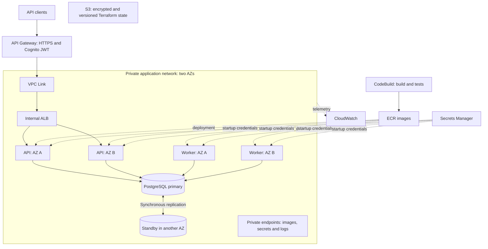

# Problem 1 — Building Castle in the Cloud

## Assumptions and why

- **A small spot-trading slice demonstrates the infrastructure.** I implemented BTC-USDT limit orders, matching, cancellation, balances, order history and market-data reads. Accounts use simulated funds; there is no custody or withdrawal flow.
- **The response acknowledges durable acceptance.** A `202` means the order, funds reservation and work command committed. Matching happens asynchronously, so execution delay is monitored separately.
- **The performance target is regional and workload-specific.** I tested 500 requests/second from Singapore with 10% order submissions. This does not establish the same latency for every traffic mix or distant clients.

## Architecture and service choices

**ECS Fargate** runs warm API and worker containers across two Availability Zones without managing EC2 hosts. The API and worker share trading code but scale independently. EC2 capacity providers could reduce sustained compute costs; EKS would add cluster operations without a demonstrated need here.

**API Gateway and Cognito** provide an AWS HTTPS hostname and access-token validation. A VPC Link and internal ALB route requests to healthy API tasks. A direct HTTPS ALB would reduce gateway request fees, but requires a domain, certificate and application JWT verification. Cloud Map could replace the ALB, with different discovery and health behaviour to validate.

**RDS PostgreSQL Multi-AZ** holds orders, balances, trades, journal postings and durable commands. Keeping them together avoids a database/queue dual write: an accepted order cannot commit without its work command. SQS or Kafka would need an outbox/relay or an equivalent recovery mechanism. Aurora is a growth option; DynamoDB would require a different transaction and order-book design. The standby provides failover, not read scaling.

**ECR and CodeBuild** build, test and publish immutable image releases. **Secrets Manager** supplies credentials, **CloudWatch** collects operational signals, and **S3** stores encrypted, versioned Terraform state. Private endpoints support task startup without NAT; NAT is simpler when unrestricted outbound access is needed. Redis is deferred until measured read pressure justifies a rebuildable cache.

Application tasks and the database have no public addresses. Security groups restrict each request hop and database access. A separate outbound-only subnet hosts temporary load generators. The infrastructure is defined in [infra/](infra/).

## How an order moves through the system

1. The gateway validates the access token and overwrites the caller identity header. The API checks input and account ownership.
2. One transaction creates the order, conditionally reserves available funds, records the journal entry and inserts a command. Only then does the API return `202`.
3. A worker takes the market lock, admits the order to the book, and matches best price followed by engine admission sequence. Two workers provide recovery capacity, not simultaneous matching of the same market.
4. Trades, balance changes, journal postings, residual quantities and command completion commit together. Execution uses the maker price and releases buyer price improvement.
5. Cancellation is another durable command. It releases the remaining reservation if a fill has not already won the race.

Amounts use fixed-precision arithmetic. Conditional balance updates prevent overspending. Account-scoped idempotency keys prevent retries from reserving funds twice; conflicting input under the same key returns `409`.

If a task fails, ECS replaces it. If a worker transaction fails, it rolls back and its command remains recoverable. Database failover can interrupt writes; connection handling and timeouts provide bounded failures and retries. Process liveness is separate from database readiness to avoid restarting healthy applications during a database outage.

## APIs and verification

The API exposes public market/order-book/trade reads and authenticated balances, order submission, history, status and cancellation. Submissions require an `Idempotency-Key`; clients reuse that key after an uncertain response.

Demo: **https://v7kn37xo96.execute-api.ap-southeast-1.amazonaws.com/v1/markets**

The recorded Singapore test completed **90,001 requests over 180 measured seconds at 500 offered RPS**, with **29 ms aggregate p99**, **54 ms submission p99**, zero unexpected responses and zero dropped iterations. The mix was 50% book reads, 20% balances, 10% history, 10% submissions and 10% recent trades, against a populated book.

All **11 correctness tests** and **10 live authentication/trading checks** passed. The post-run audit reconciled **5,001 trades**, with no financial invariant violations or pending commands. Deployment records confirm two API tasks, two workers and a private Multi-AZ database across two AZs. Fault-injection and restore tests were not repeated in this sandbox.

Results and their limits are in [evidence/results.md](evidence/results.md). The [testing guide](TESTING.md) contains the API reference, login/order/retry/cancellation examples and acceptance-test commands. Demo credentials are supplied privately.

## Scaling and cost

Scale API tasks when HTTP CPU or concurrency becomes the bottleneck, while keeping database pools bounded. Add a market-data cache or history read replicas for read pressure. When execution lag grows, improve matching/persistence and partition independent markets; adding API replicas does not solve a single hot order book. A previous environment's 80%-write test failed, so the demonstrated capacity remains the stated 10%-write profile.

The base Fargate, Multi-AZ database, endpoints and ALB estimate is **about USD 310/month**, before storage, telemetry, secrets and usage. Constant 500 RPS for 30 days adds approximately **USD 1,500 in gateway request fees** at the recorded tiers. That makes direct ALB ingress worth reassessing at sustained volume. [Pricing evidence](evidence/pricing.json).

## Deliberately left out

- Custody, deposits, withdrawals, derivatives, external price feeds and a frontend.
- Cross-region continuity, tested restore RTO/RPO, all-day capacity and surviving-AZ load tests.
- Production database privilege separation, internal-hop TLS, automatic credential refresh and alarm notification destinations.

Multi-AZ does not mean zero downtime, and backups do not prove restore time. Problem 5 demonstrates selected security controls separately; it does not modify this deployment. Deployment prerequisites, release limitations and cleanup are in [TESTING.md](TESTING.md#deployment-and-cleanup).
