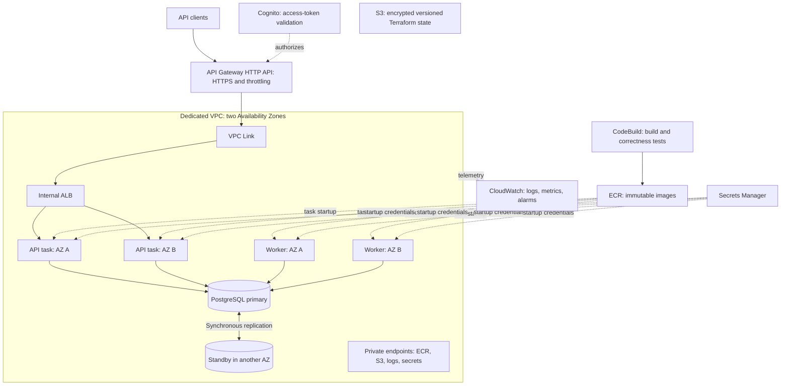

# Problem 1 — Building Castle in the Cloud

An API-only spot-trading demonstration on AWS Singapore (`ap-southeast-1`), named **dom7hc-practice**.

**Implemented:** BTC-USDT limit orders, asynchronous matching, cancellation, order-book/trade reads, account balances and history. Accounts hold simulated funds. Custody, deposits, withdrawals, derivatives and a frontend are outside this slice.

## Acceptance criteria and results

| Requirement | Implementation | How to verify |
|---|---|---|
| AWS | Terraform provisions ECS Fargate, RDS, API Gateway, Cognito and supporting services | Inspect [infra/](infra/) and [deployment evidence](evidence/deployment.json) |
| Service overview and roles | Diagram and service decisions below | Follow client → gateway → ALB → API → PostgreSQL → worker |
| High availability | Two API tasks and two workers across two AZs; private RDS Multi-AZ; bounded dependency waits | Check AZ/task/database fields in `deployment.json`; optional fault tests below |
| 500 requests/second | Regional constant-arrival k6 test, with the traffic mix stated below | Run the load test; check offered/completed requests, errors, drops and queue age |
| p99 below 100 ms | Response includes committed acceptance/reservation; matching is asynchronous | Check aggregate and per-route p99, including order submission |
| Service choices and growth | Alternatives, cost and scaling triggers below | Review the bottleneck-specific growth plan |

**Recorded result, 25 October 2026:** 90,001 measured requests over 180 seconds at 500 offered RPS; **29 ms aggregate p99**, **54 ms order-submission p99**, **zero unexpected responses and zero dropped iterations**. The populated-book workload was 50% book reads, 20% balances, 10% history, 10% placements and 10% recent trades. See [results.md](evidence/results.md) and [raw run](evidence/load-1792905854-mixed.json).

**Interpretation:** a `202` means the order, funds reservation and durable command committed. It does not mean matching completed. The benchmark covers this three-minute, regional, 10%-write profile—not every traffic mix or all-day capacity. Queue progress is checked separately.

## Architecture



Application/database subnets have no NAT or internet default route. Security groups restrict VPC Link → ALB → API and application → PostgreSQL. Private endpoints support image pulls, secrets and logging. A separate outbound-only subnet hosts temporary public-HTTPS load tests. Primary/standby AZ roles can swap during failover.

## Service decisions and alternatives

| Choice | Why it is used | Alternative considered |
|---|---|---|
| ECS Fargate | Warm containers across AZs without managing EC2 hosts | EC2 capacity providers for sustained cost optimization; EKS adds unnecessary cluster operations here |
| HTTP API + Cognito | AWS-provided HTTPS hostname, JWT checks and route throttling | Direct HTTPS ALB reduces request fees but needs a domain/certificate and application JWT verification |
| Internal ALB | Health-based task routing and connection draining | Cloud Map private integration removes the ALB but changes discovery/health behaviour |
| RDS PostgreSQL Multi-AZ | Transactions combine financial changes and durable work; managed standby/backups | Aurora for growth; DynamoDB requires a different transactional/order-book model |
| PostgreSQL command queue | Order, reservation and PLACE command commit together | SQS/Kafka need an outbox/relay or another explicit dual-write solution |
| ECR + CodeBuild | Immutable releases, isolated image builds and PostgreSQL-backed tests before publishing | Local Docker builds are supported; CodeBuild avoids workstation-specific build dependencies |
| Secrets Manager + VPC endpoints | Keep secrets out of code and support private task startup | NAT is simpler for unrestricted egress but adds internet routing and usage costs |
| CloudWatch + S3 state | Operational visibility; encrypted, versioned, locked infrastructure state | A separate observability stack can be added when its value justifies operating it |

Redis is not required initially. Add a rebuildable market-data cache only when measurements justify it. The RDS standby is for failover, **not read scaling**.

## Correctness and failure handling

- **Atomic acceptance:** one transaction creates the order, reserves funds, journals the reservation and inserts its command. Conditional updates and non-negative constraints prevent overspending.
- **Idempotency:** a unique account/key plus normalized payload hash prevents duplicate reservations. Same key/input returns the original order; different input returns `409`.
- **Matching:** a transaction-scoped market lock permits one matcher per market. Best price then engine admission sequence determines priority; HTTP receipt order is not book admission order.
- **Atomic settlement:** maker-price trades, both assets' postings, balances, order residuals and command completion commit together. Buyer price improvement is released immediately. Amounts use fixed-precision SQL numeric and Decimal arithmetic.
- **Cancellation:** a durable request may lose a race to a fill. The worker releases only the remaining reservation; clients query final status.
- **Recovery:** transaction failure rolls back work for retry. Pool error handling and timeouts bound database failures. Task liveness is separate from database readiness.
- **Limits:** database failover can interrupt writes. Multi-AZ is not zero downtime. Backups do not establish restore RTO/RPO without a restore test.

## APIs

Base URL: **https://v7kn37xo96.execute-api.ap-southeast-1.amazonaws.com**

| Method/path | Access | Result |
|---|---|---|
| `GET /health/live` | Public | Process health |
| `GET /health/ready` | Public | Database readiness |
| `GET /v1/markets` | Public | Market, increments and limits |
| `GET /v1/markets/BTC-USDT/orderbook?depth=20` | Public | Aggregated levels; depth 1–100 |
| `GET /v1/markets/BTC-USDT/trades` | Public | Latest 50 trades |
| `GET /v1/balances` | Access token | Caller-owned available/reserved funds |
| `POST /v1/orders` | Access token | Durable submission; requires `Idempotency-Key`; returns `202` |
| `GET /v1/orders?cursor=...` | Access token | Owned history, 50 rows/page and `next_cursor` |
| `GET /v1/orders/{id}` | Access token | Owned state and up to 50 recent fills |
| `DELETE /v1/orders/{id}` | Access token | Durable cancellation request; returns `202` |

Errors: `400` invalid input, `401/403` authentication/access failure, `404` absent or other-account order, `409` conflicting key, `422` insufficient funds, `503` temporary dependency failure. Retry uncertain submissions with the **same key and body**.

### Test the live APIs — PowerShell

Demo credentials are supplied privately. The authentication call below needs no AWS IAM credentials. Do not print or commit the resulting token. Run from `src/problem1`:

```powershell
$config = Get-Content ./evidence/public-config.json -Raw | ConvertFrom-Json
$base = $config.api_url
Invoke-RestMethod "$base/v1/markets"
Invoke-RestMethod "$base/v1/markets/BTC-USDT/orderbook?depth=20"

$credential = Get-Credential -Message 'Enter the supplied demo username and password'
$authBody = @{
  AuthFlow = 'USER_PASSWORD_AUTH'
  ClientId = $config.client_id
  AuthParameters = @{
    USERNAME = $credential.UserName
    PASSWORD = $credential.GetNetworkCredential().Password
  }
} | ConvertTo-Json -Depth 4
$auth = Invoke-RestMethod -Method Post `
  -Uri "https://cognito-idp.$($config.region).amazonaws.com/" `
  -ContentType 'application/x-amz-json-1.1' `
  -Headers @{'X-Amz-Target'='AWSCognitoIdentityProviderService.InitiateAuth'} `
  -Body $authBody
$authBody = $null
$headers = @{Authorization="Bearer $($auth.AuthenticationResult.AccessToken)"}
Invoke-RestMethod "$base/v1/balances" -Headers $headers

# Non-crossing demo buy: reserve 1 USDT without intentionally matching liquidity.
$headers['Idempotency-Key'] = [guid]::NewGuid().ToString()
$body = '{"market":"BTC-USDT","side":"BUY","price":"1.00","quantity":"1.00"}'
$order = Invoke-RestMethod -Method Post -Uri "$base/v1/orders" `
  -Headers $headers -ContentType 'application/json' -Body $body
$retry = Invoke-RestMethod -Method Post -Uri "$base/v1/orders" `
  -Headers $headers -ContentType 'application/json' -Body $body
if ($retry.id -ne $order.id) { throw 'Idempotency check failed' }
Invoke-RestMethod "$base/v1/orders/$($order.id)" -Headers $headers
Invoke-RestMethod -Method Delete -Uri "$base/v1/orders/$($order.id)" -Headers $headers

for ($i=0; $i -lt 20; $i++) {
  $state = Invoke-RestMethod "$base/v1/orders/$($order.id)" -Headers $headers
  if ($state.status -in @('CANCELLED','FILLED')) { break }
  Start-Sleep -Milliseconds 500
}
$state
Invoke-RestMethod "$base/v1/balances" -Headers $headers
```

Expected: the retry has the same ID; cancellation eventually reaches a terminal state. Funds return for an unfilled cancellation; FILLED means a trade won the race. To test matching and cross-account rejection, use the automated functional check with two supplied accounts.

## Acceptance test guide

**Local correctness:** use a disposable PostgreSQL 18 database `trading` on loopback port 55432 with password `local-test-only`. Do not reuse a shared database: the suite truncates its fixtures and injects a failing SQL trigger. From `src/problem1/app`:

```powershell
$env:DB_HOST='127.0.0.1'; $env:DB_PORT='55432'
$env:DB_USER='postgres'; $env:DB_PASSWORD='local-test-only'
$env:DB_NAME='trading'; $env:DB_SSL='false'
npm.cmd ci --registry=https://registry.npmjs.org
npm.cmd test
```

Expected: **11 tests pass**, covering overlap, replay, overspending, price-time matching, exact amounts, rollback/retry, cancellation, ownership and pagination.

**Live/operator checks:** require authorized deployment-account access and initialized backend configuration. Helpers are pinned to this sandbox/profile; another account requires deliberate configuration changes. These commands write demo data, run temporary paid tasks or send traffic:

```powershell
aws sso login --profile AWSAdministratorAccess-730335245469
python scripts/manage.py bootstrap             # Configure encrypted/versioned state backend
.\scripts\verify.ps1                          # 10 live checks, then financial audit
python scripts/manage.py admin seed-book       # Idempotent 400-order fixture
python scripts/manage.py load 500 180s mixed
python scripts/manage.py admin audit
python scripts/manage.py report
```

Pass criteria: expected HTTP statuses; identical retry order ID; matching/cancellation complete; aggregate and each exercised route p99 <100 ms; unexpected response rate <0.1%; **zero dropped iterations**; measured count within five requests of 90,000 at the timing boundary; financial violation counts zero and queue drained. Recorded unexpected responses were zero. Inspect queue age during the run; a fast 202 with growing backlog is not sustainable capacity.

**HA checks:** inspect [deployment.json](evidence/deployment.json) for AZ distribution/Multi-AZ/private settings. Optional `python scripts/manage.py recovery task` and `recovery database` stop a task or force database failover; run only in an approved isolated test window. These fault tests were **not repeated in the current sandbox**. Configuration evidence is not fault-injection or restore evidence.

## Scaling, cost and remaining work

- Scale API tasks for measured HTTP CPU/concurrency; retain bounded pool sizes. Two workers provide recovery, not parallel execution of the same market.
- Add Redis/read replicas for measured market/history read pressure; keep balance-sensitive reads authoritative.
- Improve matching/persistence when command age grows. Partition independent markets; one hot market still needs its own capacity strategy. A previous sandbox's 80%-write stress profile failed, so no arbitrary-mix 500-RPS claim is made.
- Use a non-burstable database when sustained demand/credit behaviour warrants it. Test longer runs and surviving-AZ headroom before promising continuous capacity.
- Base Fargate/RDS/endpoints/ALB estimate: **about USD 310/month**, before storage, telemetry, secrets and usage. Constant 500 RPS for 30 days adds about **USD 1,500 in HTTP API request fees** at recorded tiers; a direct custom-domain ALB is worth reassessing at that volume. See [pricing.json](evidence/pricing.json).
- Production gaps: bootstrap database identity, internal HTTP hops, rotation/redeployment automation, alarm notification destinations and tested restore. Problem 5 demonstrates selected controls separately; it does not modify this deployment.

## Deploy and remove

For a **new stack only**, run `.\scripts\deploy.ps1 -Initial -ImageTag <new-immutable-tag>` from this folder. Review the account/profile, cost and plan first. `-Initial` scales services to zero; do not use it on an existing live stack. For schema-changing releases, register and run the migration using the intended new image before service rollout; the current wrapper can otherwise select the existing worker definition. ECR rejects reused tags.

To remove this stack, inspect `python scripts/manage.py terraform plan -destroy`, then run an approved `python scripts/manage.py terraform destroy`. A final RDS snapshot remains billable; remove it deliberately if unnecessary. Delete retained RDS log groups and the versioned state/source bucket only after stack deletion, including bucket versions/delete markers. Secrets use a seven-day recovery window. Never delete state first.
