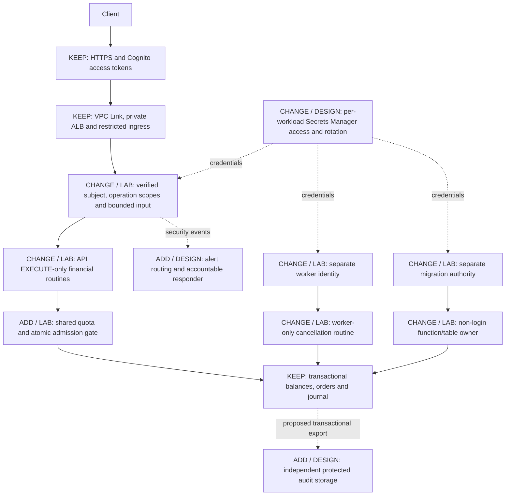

# Problem 5 — Fortify the Castle

**Implemented:** an independent Docker lab that hardens an order-reservation/cancellation slice of Problem 1. It demonstrates database privilege separation, JWT ownership checks and shared admission controls.

**Boundary:** all code, secrets, networks and data belong to `dom7hc-practice-p5`. No Problem 1 files, deployment, credentials, Terraform state or AWS resources are changed or used at runtime. This is not a full matching engine or an AWS security deployment.

## 1. Updated architecture — security changes marked

**KEEP** = existing Problem 1 design. **CHANGE/ADD · LAB** = implemented and tested locally. **DESIGN** = proposed production work, not deployed.



The lab replaces the managed identity boundary with locally signed test JWTs: only the trusted test runner receives the private key; API replicas receive the public key. The target AWS design retains Cognito and maps application-specific permissions from approved scopes/claims. The lab database is one local PostgreSQL instance, not Multi-AZ RDS.

## 2. Why each change exists and what it protects against

| Change | Implementation | Protection and acceptance test |
|---|---|---|
| Separate database authority | Non-login `p5_owner`; trusted migrator; separate API/worker logins | Runtime credentials cannot read/mutate base tables, perform DDL, rewrite journal history or assume owner/admin roles; direct SQL denial tests |
| Narrow financial routines | SECURITY DEFINER, pinned trusted search path, schema-qualified SQL, revoked PUBLIC execution, explicit grants | Prevents arbitrary financial mutations and object-resolution substitution; valid operations succeed while cross-role routine calls fail |
| Verified caller and operation scopes | RS256 allowlist, issuer/audience/expiry/subject validation; scopes per route; subject-bound ownership | Rejects forged/expired/wrong-target tokens, read-only mutations and access to another account's order; header/body identity substitution tests |
| Shared accepted-order quota | Four accepted new orders per account per 60-second account window, stored in PostgreSQL | Switching between replicas does not multiply quota; rejection leaves funds unchanged |
| Atomic admission and replay | One transaction-scoped gate; capacity 20 outstanding reservations; replay lookup before new quota/capacity charges | Concurrent requests cannot over-admit or reserve twice; rejected requests reserve nothing; mismatched key/input returns 409 |
| Cancellation outside new-order admission | API requests cancellation; worker releases the stored amount once | Customers can release funds during admission closure; duplicate cancellation cannot double-refund |
| Restricted containers and secrets | Non-root API/worker, read-only roots, dropped capabilities, no-new-privileges, narrow read-only secret mounts | Reduces writable/runtime authority; Docker inspection confirms actual settings and source/package hashes |
| Local network isolation | Loopback API ports; no published database port; internal backend network | Limits host exposure; runtime inspection checks mappings and network configuration |

All financial writes and accepted-order quota updates commit together. Fixed-precision numeric values, conditional balance updates and non-negative constraints prevent overspending. Tests reconcile balances with postings after every case.

## Acceptance criteria and test guide

| Exercise requirement | Delivered | Reviewer check |
|---|---|---|
| Updated architecture with changes marked | Diagram above separates KEEP, LAB and DESIGN | Compare diagram with `compose.yml`, `db/security.sql` and `app/src/` |
| Reasons and threats for each change | Control table above | Inspect denial/ownership/concurrency cases in `app/test/security.test.js` |
| Deliberate omissions and trade-offs | Section 3 below | Check the limit is stated without claiming an unimplemented control |
| Priorities and missing facts | Section 4 below | Identify release blockers, deferred work and owners needed to resolve assumptions |
| Working security demonstration | Two APIs, restricted worker and isolated PostgreSQL | Run the suite and inspect sanitized evidence |

Requirements: Node 24, Docker Compose v2 and PowerShell. From `src/problem5`:

```powershell
.\scripts\run.ps1
```

This generates/preserves local fixture credentials, builds/starts services, checks runtime restrictions and runs the security suite. **The suite resets its dedicated `p5_security` fixture database. Do not run it against retained data.** A second copy using the same Docker project name on the same daemon is not a separate lab.

Expected: **12 cases pass**, `all_checks_passed: true`, and financial reconciliation counts `negative`, `unbalanced` and `unreconciled` are all zero. See [security-results.json](evidence/security-results.json) and [runtime-controls.json](evidence/runtime-controls.json). The recorded run passed all checks.

The cases cover invalid JWTs, scope restrictions, ownership/spoofing, SQL privilege denial, role separation, concurrent replay, overspending, cross-replica quota, concurrent capacity, cancellation during closure, input validation and security-definer configuration.

For an already built compatible image, `.\scripts\run.ps1 -SkipBuild` avoids registry access. The inspector compares app/package/lockfile hashes against each runtime. It does **not** attest the base image or installed SQL schema. Rebuild for Dockerfile/base/dependency changes; reset the disposable P5 volume for changed bootstrap SQL.

Read-only checks:

```powershell
Invoke-RestMethod http://127.0.0.1:18085/health
Invoke-RestMethod http://127.0.0.1:18086/health
docker compose -p dom7hc-practice-p5 -f compose.yml ps
```

Stop only this project with `.\scripts\cleanup.ps1`; add `-ResetData` to delete its fixture volume. Keep generated passwords aligned with a retained volume. No global prune or AWS cleanup is required.

## 3. Deliberately left out and accepted trade-offs

- **Local issuer and simulated funds:** no Cognito/MFA/real-asset integration. Production retains managed identity; session revocation and key rotation need a defined lifecycle.
- **Subject trusted at the API/database boundary:** SQL routines constrain mutations but do not independently verify JWT identity. A fully compromised API with its DB credential can invoke allowed routines for another subject. Stronger independent authorization is required if that threat is in scope.
- **Runtime-protected journal, not administrator-proof immutability:** migration/admin authority can still change data. Independent audit export/retention is design-only and needs an approved retention/deletion policy.
- **Accepted-new-order quota, not all-request throttling:** reads, replays and failed requests still consume work. Public exposure needs request-level abuse controls. The global gate favors simple atomicity over concurrency; no P5 500-RPS claim is made.
- **Local plaintext and file-backed secrets:** acceptable only for the loopback dummy-data lab. Compose secrets are mounts, not an encrypted vault; the host/test administrator remains trusted. Production needs verified transport and per-workload secret/rotation policies.
- **No WAF, automatic rotation, audit export or paging deployment:** these are marked production proposals. HTTP API has no direct WAF integration; use a supported attachment architecture and prevent origin bypass. A WAF does not solve authenticated business overload.
- **No custody, full matcher integration, restore drill or penetration test:** separate work. The twelve cases establish selected lab behaviours, not production approval.

## 4. Priorities and missing facts

**First:** restrict financial database authority, verify caller ownership and bound new work before reserving funds. These are the implemented controls.

**Before real-money release:** review financial routines/identity boundaries, add public abuse controls, protected audit/recovery evidence, actionable incident routing and a tested restore. Re-measure latency after integrating security into the full system.

| Missing fact | How to obtain it | Interim assumption |
|---|---|---|
| Real custody, withdrawals and asset value | Product/finance data-flow review | Dummy funds, no custody/withdrawals |
| Legitimate account peaks and execution-lag policy | Workload measurements and product acceptance | Low lab limits; cancellation stays available |
| Operator/migration identities and MFA | Platform/identity owner and role review | Trusted local fixture admin; production migration access must be controlled |
| Existing audit/detection services and incident owner | Security/platform inventory | Reuse established controls where suitable; do not create duplicate account-wide services blindly |
| Retention/privacy obligations and RPO/RTO | Data owner and restore exercise | No compliance or recovery-time claim |
| Domain/PKI and latency/cost allowance | Platform inventory and re-benchmark | Production transport changes are design-only |

Sources: [PostgreSQL security-definer guidance](https://www.postgresql.org/docs/current/sql-createfunction.html#SQL-CREATEFUNCTION-SECURITY), [AWS API type/WAF support](https://docs.aws.amazon.com/apigateway/latest/developerguide/http-api-vs-rest.html), [Compose secrets](https://docs.docker.com/compose/how-tos/use-secrets/).
