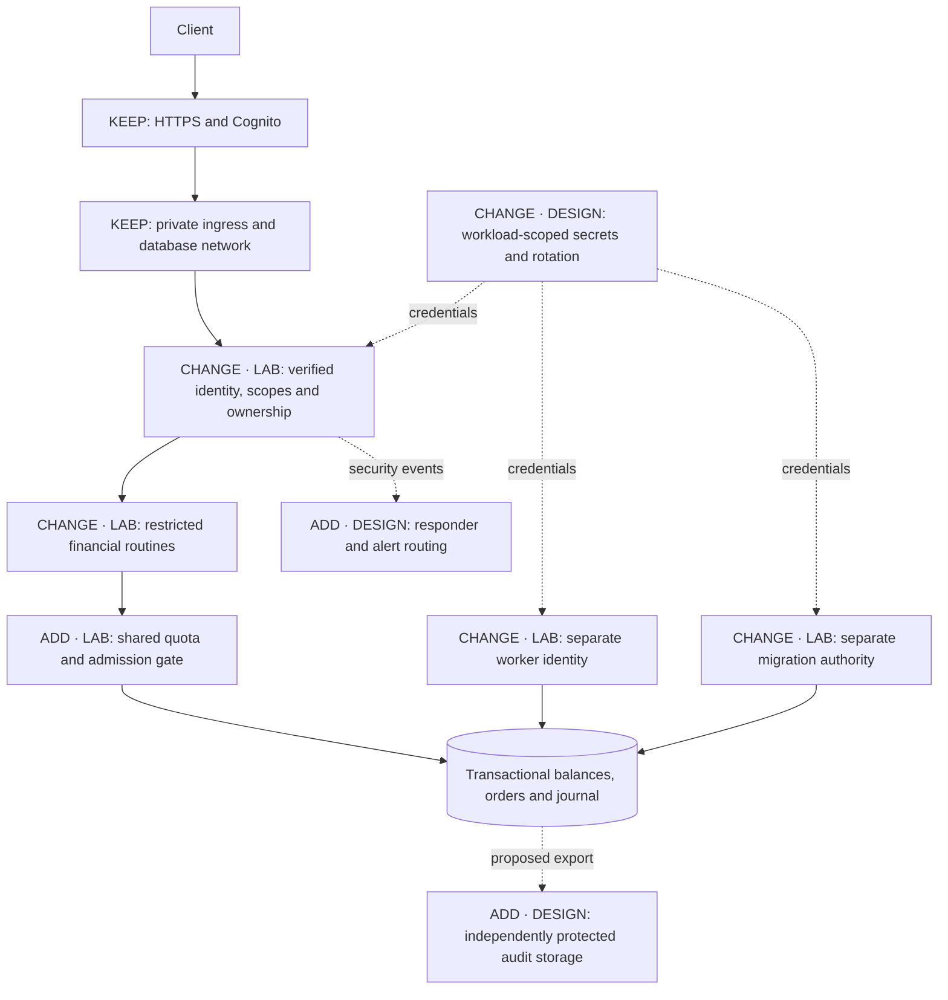

# Problem 5 — Fortify the Castle

## Assumptions and scope

- **Protect the financial transition first.** I focused on who may reserve or release funds, how caller ownership is established, and when new work should be rejected.
- **Demonstrate the controls in an independent lab.** Two API replicas, a cancellation worker and PostgreSQL run under `dom7hc-practice-p5`. Problem 1's code, deployment, credentials and data remain untouched.
- **Use simulated funds and a local test issuer.** The lab proves selected security boundaries; it does not deploy the proposed AWS changes or rebuild the matching engine.

## Updated architecture

The diagram marks retained Problem 1 controls, changes demonstrated in the lab, and production proposals that remain design-only.

The target AWS design keeps Cognito, private ingress and Multi-AZ RDS. The local lab uses its own JWT signing fixture and one PostgreSQL container. Only the trusted test runner receives the private signing key; API replicas receive the public key.

## What I changed and why

### Restrict database authority

Problem 1 uses a bootstrap database identity at runtime. I replaced that pattern in the lab with separate API, worker and migration identities. The API can execute approved balance/order routines; the worker can execute only cancellation processing. Neither can read or edit base tables directly, change the schema, rewrite journal history or assume the owner role.

Financial routines run under a non-login, non-superuser owner, with a fixed trusted search path and explicit execution grants. Reservation, quota, order and journal changes commit together. This limits arbitrary mutations if runtime credentials are misused, while keeping migration authority separate and trusted.

### Bind actions to the verified caller

Each API verifies the JWT signature, allowed algorithm, issuer, audience and expiry, then checks the operation scope. Ownership comes from the verified subject, not a supplied account field or forwarding header. Another account's order returns the same 404 as an unknown order.

This blocks forged identities, read-only tokens used for mutations and caller-controlled account substitution. It does not independently authenticate the subject inside PostgreSQL after a complete API compromise; that remains an explicit production risk.

### Share limits and keep cancellation available

A per-replica counter would give a caller separate quotas on each API. The lab stores quota and admission state in PostgreSQL and checks them under one transaction-scoped gate before reserving funds.

The default allows four accepted new orders per account per 60-second account window, with at most 20 outstanding reservations. Existing idempotent retries return the original result without charging quota again. Rejections reserve nothing. Cancellation remains available during admission closure, and the worker releases the stored amount only once.

### Reduce runtime exposure

API and worker containers run as non-root users with read-only roots, dropped capabilities and no-new-privileges. Each receives only its required read-only secret mounts. APIs publish loopback-only ports; the database publishes no host port and shares an internal network with the worker.

These controls reduce access and writable surface. They do not turn host files into a secret vault or make the Docker host untrusted.

## Verification

All **12 security integration cases passed**, including invalid tokens, missing scopes, ownership/header spoofing, direct SQL privilege denial, cross-role access, concurrent replay, overspending, shared quota/capacity and cancellation during admission closure. Financial reconciliation found no negative balances, unbalanced events or unreconciled balances.

Docker inspection confirmed the runtime restrictions, narrow secret mounts and network mappings. The copied submission also passed the suite in a separate verification project with fresh data.

Run `.\scripts\run.ps1` from `src/problem5` to reproduce the checks. The suite resets its disposable fixture database. Commands, pass conditions, evidence links and scoped cleanup are in [TESTING.md](TESTING.md).

## Deliberately left out and accepted trade-offs

- **No full AWS hardening rollout.** WAF, MFA, automatic rotation, independent audit export and paging remain marked proposals. HTTP API has no direct WAF integration, so a WAF requires a supported ingress design and bypass prevention.
- **No administrator-proof journal.** Runtime roles cannot rewrite it, but migration/admin authority can. Independent retention and audit ownership need a separate policy and implementation.
- **No general request limiter or performance claim.** The quota counts accepted new orders; reads, replays and rejected attempts still consume work. The simple global gate trades concurrency for understandable atomicity. P5 does not inherit P1's 500-RPS result.
- **Local plaintext and file-backed secrets.** Accepted only for the loopback, dummy-data lab. Production needs verified transport, managed identity lifecycle and workload-scoped secret access. A compromised API can still invoke allowed routines with another subject.
- **No custody, full matcher integration, restore drill or penetration test.** The test suite demonstrates selected behaviours, not production approval.

## Priorities and facts still needed

Before real-money release, I would require reviewed financial privileges and identity boundaries, public abuse controls, independently protected audit/recovery evidence, an incident owner receiving alerts and a tested restore. I would re-measure latency after integrating these controls into the full system.

The remaining decisions need product and platform facts:

- Confirm custody, withdrawals and asset value with the product/finance owner; this lab assumes none.
- Measure legitimate account peaks and agree an execution-lag policy before choosing production limits; cancellation must remain available.
- Review operator/migration identities, MFA, existing security services and responder ownership with platform/security teams rather than adding duplicate controls blindly.
- Agree retention, privacy, RPO/RTO, domain/PKI and latency/cost requirements with their owners. This lab makes no compliance or recovery-time claim.

References: [PostgreSQL security-definer guidance](https://www.postgresql.org/docs/current/sql-createfunction.html#SQL-CREATEFUNCTION-SECURITY), [AWS API type/WAF support](https://docs.aws.amazon.com/apigateway/latest/developerguide/http-api-vs-rest.html), [Compose secrets](https://docs.docker.com/compose/how-tos/use-secrets/).
